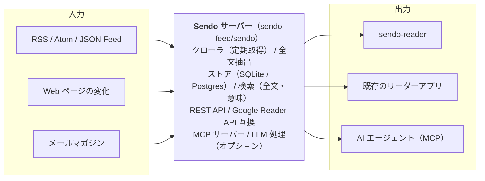

# Sendo インセプションデッキ

> **鮮度を、導く。** — Fresh feeds, guided.
> sendo-feed · 2026-11-13 叩き台
>
> インセプションデッキの叩き台。これまでの相談で決まったことを埋め、未定のところは [ ] の空欄にしてある。2人で1枚ずつ確認して、空欄を埋めていく。

---

## 1. 我々はなぜここにいるのか

**毎日読む情報の入口を、自分たちの手に取り戻すため。**

| 理由 | 内容 |
|---|---|
| 不自由なRSSリーダー | Google Reader の時代から続く習慣。でも Feedly は、使いたい機能の多くがプレミアム限定。 |
| 閉じていくSNS | X はログインなしでは読めない。誰でも購読できる開かれた配信の仕組みが、改めて必要。 |
| 読むのは人だけじゃない | エージェントがフィードを読み、要約し、仕分ける時代。LLM から扱える入口が欲しい。 |

> このプロジェクトが存在する理由を一言で言えるか。カードの3つはこれまでの雑談から拾ったもの。足りない理由があれば足す。

---

## 2. エレベーターピッチ

| 項目 | 文 |
|---|---|
| ニーズ | 新鮮な情報を、自分の道具で、人にもAIにも届けたい |
| 対象 | RSSを日常的に読む開発者や、情報収集をエージェントに任せたい人向けの、 |
| 名前 | **Sendo** というプロダクトは、 |
| カテゴリー | オープンソースのフィード集約サーバーとリーダーです。 |
| 利点 | 購読・取得・検索・要約を、REST API と MCP から自由に扱うことができ、 |
| 代替手段 | Feedly などの SaaS 型 RSS リーダーとは違って、 |
| 差別化 | セルフホストでき、既存のリーダーアプリも使え、LLM 対応が最初から備わっている。 |

> 30秒で説明できるか。対象と差別化の言い方は特に2人で揉んで決める。

---

## 3. パッケージデザイン

**OPEN SOURCE FEED SERVER — Sendo**
鮮度を、導く。 / *Fresh feeds, guided.*

1. **API・MCP ファースト** — 人もエージェントも、同じ入口からフィードを扱える
2. **好きなリーダーで読める** — Google Reader API 互換で、Reeder や NetNewsWire がそのまま使える
3. **自分で持てる** — OSS・セルフホスト。データも設定も手元に置ける

> 名前は「鮮度」。先導・船頭とも読めて、どちらの意味でも導いてくれる、というのが由来。箱の裏に書く売り文句を3つに絞る。

---

## 4. やらないことリスト

| やる | やらない | あとで決める |
|---|---|---|
| RSS / Atom / JSON Feed の取得と保存 | SNS のスクレイピング前提の機能 | LLM の要約・スコアリングの範囲 |
| REST API と MCP サーバー | ホスティングサービスの運営 | マルチユーザー対応 |
| Google Reader API 互換 | 独自のフィード形式 | ネイティブのモバイルアプリ |
| OPML のインポートとエクスポート | [ ここに追加 ] | Fever API 対応 |

> 叩き台。「やらない」と書いたものは今は作らない、と2人で合意するためのもの。迷うものは「あとで決める」に置く。

---

## 5. ご近所さんを探せ

**コアチーム：Hiroki / Yuichi** — 設計・実装・意思決定。デプロイ先はそれぞれ調達

| ご近所さん | 関わり方 |
|---|---|
| コントリビューター | 公開後に Issue と PR で参加 |
| セルフホストする利用者 | 自分の環境にデプロイして使う |
| 既存のリーダーアプリ | Reeder、NetNewsWire、Fluent Reader など |
| AI エージェント | Claude などの MCP クライアント |
| フィードの提供元 | ブログ、ニュースサイト、メールマガジン |
| デプロイ先 | VPS、Cloudflare など [ 各自記入 ] |

> プロジェクトに関わる人・システムを洗い出す。OSS なので、利用者と既存エコシステム（リーダーアプリや MCP クライアント）がご近所さんになる。

---

## 6. 解決案を描く

技術スタック：TypeScript（Hono）で、第1版は Cloudflare 前提。緩衝層を挟んで後から移植できるようにする → [decisions/tech-stack.md](decisions/tech-stack.md)（提案中）

> 全体像。サーバーが本体で、リーダーは利用者の一つ。LLM 機能はすべてオプションで、なくても普通の RSS サーバーとして完結させる。

---

## 7. 夜も眠れなくなる問題

| 心配ごと | いまの対策案 |
|---|---|
| 本業が忙しく、2人とも手が止まる | マイルストーンを小さく切り、定期的に同期する |
| Google Reader API に正式な仕様がない | 対象クライアントを絞り、Miniflux などの実装を参照する |
| 外部 URL を取りに行くサーバーの安全性 | 取得先の制限（SSRF 対策）と静的解析を最初から入れる |
| LLM のコストと品質のばらつき | LLM 機能はすべてオプション、API キーは各自持ち |
| 取得先サイトの制限や利用規約 | 取得間隔を調整し規約を守る。SNS は深追いしない |
| [ ここに追加 ] | [ 対策 ] |

> 起きたら困ることを先に口に出しておく。対策は今の案なので、2人で見直す。

---

## 8. 期間を見極める

| フェーズ | 内容 | 目安 |
|---|---|---|
| **Phase 1：MVP** | 取得と保存、REST API、Google Reader API 互換、MCP サーバー、OPML | [ 　週間 ] |
| **Phase 2：Feedly 有料版の代わり** | 全文抽出、全文検索、フィルタとルール、通知、RSS のないサイトのフィード化 | [ 　週間 ] |
| **Phase 3：LLM 活用** | 要約とダイジェスト、自動分類、関連度スコア、クラスタリング、意味検索 | [ 　週間 ] |

**最初のゴール：Feedly の OPML を移して、毎日 Sendo で読む**

各フェーズの機能の詳細は [features.md](features.md) にある。

> 期間の目安は空欄。まずは自分たちが毎日使える状態（ドッグフーディング）を最初のゴールにする案。

---

## 9. トレードオフスライダー

| 観点 | ← 譲れる　　　　　　譲れない → | 位置 |
|---|---|---|
| ランニングコストの低さ | `├────────●─┤` | 88% |
| 試作と公開の速さ | `├──────●───┤` | 72% |
| コードの品質・テスト | `├─────●────┤` | 56% |
| 移植しやすさ（どこでも動く） | `├───●──────┤` | 40% |
| 機能の多さ | `├──●───────┤` | 約25%（要確認） |

つまみの位置は仮。同じ高さに2つ並べない、が決まり。2人で動かして決める。

> 何を優先し、何を譲るか。第1版は Cloudflare の無料枠で、試作を速く回すことを優先する（[decisions/tech-stack.md](decisions/tech-stack.md)）。移植しやすさは「すぐ移植できる」ではなく「緩衝層で移植の妨げを作らない」程度に留める。テストを中ほどに置くのは、作り直しを気軽にするための安全網だから。

---

## 10. 何がどれだけ必要か

**人**
- hiroki：[ 担当領域 ]
- yuichi：[ 担当領域 ]
- コントリビューター：公開後に募集

**環境**
- GitHub org：sendo-feed（作成済み）
- リポジトリ：sendo ／ sendo-reader
- デプロイ先：各自で調達

**お金**
- 開発・CI：無料枠の範囲で
- LLM：各自の API キー
- ドメイン：[ 要否と名前 ]

> 役割分担の案：取得・保存・互換 API の層と、MCP・LLM の層で分けると境界がはっきりする。

---

## 11. 次に決めること

1. テックスタック：TypeScript ＋ Hono、第1版は Cloudflare 前提 → [decisions/tech-stack.md](decisions/tech-stack.md)（提案中、2人で合意する）
2. 役割分担：サーバーの層と、MCP・LLM の層
3. ライセンス：[ MIT ／ Apache-2.0 ／ AGPL-3.0 ]
4. Phase 1 の期日：[ 　年　月　日 ]
5. README・CONTRIBUTING・.claude/ の整備

> ここで決まったことは、sendo リポジトリの docs/decisions/ にテーマごとのファイルとして残す（[decisions/documentation.md](decisions/documentation.md)）。

---

## 12. 私たちの進め方

**試作を繰り返し、一度決めたことでも気軽に変える。**

| 原則 | 内容 |
|---|---|
| 当面は2人だけ | 関わるのは Hiroki と Yuichi だけ。2人が合意すれば、いつでも方針を変えてよい |
| 試作を先に | 迷ったら議論より先に動くものを作って比べる。捨てる前提の試作を歓迎する |
| 決定は仮置き | 決定も「その時点の最善」。覆すときは docs/decisions/ のファイルを書き換え、なぜ変えたかはコミットメッセージに残す |
| 守るのは理由と安全網 | 作り直しの費用は小さいが、判断の理由を忘れることと、壊れたことに気づかないことは高くつく。だから決定の理由（コミットメッセージ）とテストには手間をかける |

> 人の手でコードを書いていた頃と違い、今はコード生成そのものの費用が小さい。作り直しを恐れて慎重に決めるより、試して確かめて変えるほうが速い。コントリビューターを迎える段階になったら、この進め方を見直す。
