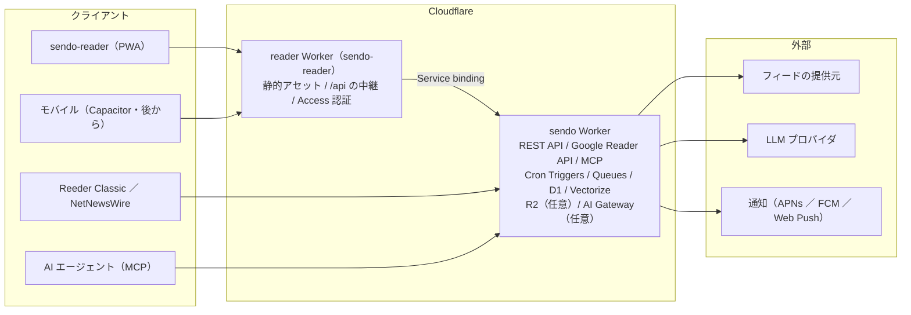

# Sendo 技術構成

> Tech stack / Repositories / Directories
> sendo-feed · 2026-11-13 叩き台
>
> これまでの相談で決まった方針をまとめた叩き台。（案）とあるものと最後の未決事項は、docs/decisions/ で確定させる。
> 確定させたものも仮置きで、試作して合わなければ変える（インセプションデッキ「12. 私たちの進め方」）。

---

## 1. 方針

| # | 方針 | 内容 |
|---|---|---|
| 01 | Cloudflare ネイティブ | 第1版は Workers・D1・Queues・Cron で完結させる。Cloudflare 固有の部分は緩衝層（`src/platform/`）に閉じ込め、Node や Docker への逃げ道は残す（[decisions/tech-stack.md](decisions/tech-stack.md)） |
| 02 | API を土台に、3つの入口 | REST API を正とし、CLI・Skill とリモート MCP を薄く乗せる。記事本文は信頼できないデータとして扱う |
| 03 | ローカルファーストのクライアント | 画面はネットワークを待たない。起動時に差分を1回で同期する |
| 04 | 既存のリーダーとつながる | Google Reader API 互換で Reeder Classic や NetNewsWire から読める |
| 05 | LLM はオプション | 設定しなくても、普通の RSS サーバーとして完結する |
| 06 | 中核は UI から切り離す | 同期エンジンとローカル DB（SQLite）を共通にし、Web とネイティブで使い回す |

> この先の技術選定は、すべてこの6つの方針から決めている。

---

## 2. 全体像



> 自前のリーダーは reader Worker 経由で sendo とつながり、ブラウザからは同一オリジンに見える。外部のリーダーや AI エージェントは sendo に直接つながる。

---

## 3. テックスタック：sendo（サーバー）

| 領域 | 選定（案） | メモ |
|---|---|---|
| ランタイム | Cloudflare Workers | 個人利用は無料枠に収まる想定 |
| 言語・FW | TypeScript ＋ Hono | MCP SDK が成熟。Node・Bun でも動く |
| API 定義 | zod-openapi（コードから生成） | 生成した OpenAPI を reader が取り込む |
| DB | D1（SQLite）＋ Drizzle | Postgres 対応は Cloudflare 以外向けに後で |
| 非同期処理 | Cron Triggers ＋ Queues | 取得・全文抽出・LLM 処理を分ける |
| 全文抽出 | Readability ＋ linkedom | Workers 上で DOM を扱う |
| 検索 | FTS5（D1）／ Vectorize | 意味検索は Phase 3 |
| エージェント連携 | リモート MCP ＋ CLI・Skill | MCP は仕様 2026-07-28 準拠で /mcp に直接載せる |
| LLM | OpenAI 互換で差し替え | Claude・OpenAI・Workers AI・Ollama |
| 認証 | Cloudflare Access ／ API トークン | 個人利用は Access で済ませる |

> テストは Vitest と Workers 用のテストプール。Rust は本体には使わず、ボトルネックが見えたら解析や抽出だけ Wasm にする選択肢を残す。

---

## 4. テックスタック：sendo-reader（クライアント）

| 領域 | 選定（案） | メモ |
|---|---|---|
| UI | Svelte 5 | ネイティブとの共有を優先するなら React を再検討 |
| ビルド・配信 | Vite ＋ Workers Static Assets | Pages は使わない |
| サーバー接続 | reader Worker → Service binding | 同一オリジンで CORS 不要。外部の sendo にも直結可 |
| PWA | vite-plugin-pwa（Workbox） | アプリの外枠をキャッシュして即起動 |
| ローカル DB | SQLite（Web は Wasm ＋ OPFS） | 全プラットフォームで同じスキーマ |
| 同期 | packages/core | 起動時に差分を1リクエストで取得、楽観的更新 |
| API クライアント | openapi-typescript ＋ openapi-fetch | sendo の OpenAPI から型を生成 |
| ネイティブ | Capacitor（後から） | バックグラウンド更新・共有拡張・APNs |
| 通知 | Web Push（VAPID） | 送信は sendo 側。APNs ／ FCM に差し替え可 |
| 品質の関所 | Playwright ＋ Lighthouse CI | JS は gzip 後 100KB 以下、操作の反応 100ms 以内 |

> 最優先は「サクサク動く」こと。iOS ではバックグラウンドで同期できないので、起動時の1回の同期の速さが体感を決める。

---

## 5. リポジトリ構成：sendo-feed

| リポジトリ | 役割 |
|---|---|
| `sendo` | サーバー本体。REST API、Google Reader API 互換、MCP、取得ジョブ。OpenAPI を生成して `spec/` に置く |
| `sendo-reader` | 公式リーダー。`packages/core` と `apps/web`・`apps/mobile` のモノレポ。型は sendo の OpenAPI から生成 |
| `.github` | Organization のプロフィール README、共通の CONTRIBUTING.md（コミット規約など）、Issue・PR テンプレート |

- **共通：** pnpm、TypeScript、GitHub Actions、Biome（案）
- **記録：** 決定は各リポジトリの `docs/decisions/` にテーマごとのファイルで残し（経緯は git の履歴）、議論は Organization の Discussions で行う
- **AI 開発：** 開発は主に Claude Code、レビューは主に Codex。エージェント共通の指示は `AGENTS.md` に書き、`CLAUDE.md` はそれを読み込む。`.claude/` にスキルと推奨プラグインを置き、Claude Code の環境を揃える

> API の定義は sendo が持ち、sendo-reader はそれを取り込むだけ。リポジトリは2つでも、API の定義は1か所にする。

---

## 6. ディレクトリ構成：sendo

```text
sendo/
├── .claude/
│   ├── settings.json          # 推奨プラグイン
│   └── skills/                # Sendo 独自の規約
├── .github/workflows/         # CI・デプロイ
├── docs/
│   └── decisions/             # tech-stack.md …
├── spec/
│   └── openapi.json           # 生成物
├── src/
│   ├── index.ts               # fetch / scheduled / queue
│   ├── api/                   # REST API
│   ├── greader/               # Google Reader API 互換
│   ├── mcp/                   # ツール・リソース
│   ├── jobs/                  # Cron・Queues
│   ├── fetcher/               # 取得・解析・全文抽出
│   ├── search/                # FTS5・意味検索
│   ├── llm/                   # 要約・分類（任意）
│   ├── notify/                # Web Push・APNs・FCM
│   ├── db/                    # Drizzle スキーマ
│   ├── platform/              # 緩衝層のインターフェース
│   │   └── cloudflare/        # D1・Queues・R2 などの実装
│   └── lib/
├── migrations/                # D1
├── test/
├── wrangler.jsonc
├── AGENTS.md                  # エージェント共通の指示・レビュー観点
├── CLAUDE.md                  # AGENTS.md を読み込む
└── README.md
```

> 1つの Worker に fetch（API・MCP）、scheduled（Cron）、queue（Queues）の3つの入口がある。`src/` は機能ごとに分け、入口は `index.ts` に集める。Cloudflare のバインディングに触れてよいのは `index.ts` と `platform/cloudflare/` だけ。

---

## 7. ディレクトリ構成：sendo-reader

```text
sendo-reader/
├── .claude/
├── .github/workflows/         # CI・Lighthouse CI
├── docs/decisions/            # local-first.md …
├── packages/
│   └── core/                  # 同期エンジン（UI 非依存）
│       ├── api/               # OpenAPI から生成
│       ├── db/                # SQLite スキーマ
│       ├── sync/              # 差分同期・操作キュー
│       └── models/
├── apps/
│   ├── web/                   # PWA（Svelte 5 ＋ Vite）
│   │   ├── src/
│   │   │   ├── routes/
│   │   │   └── components/
│   │   ├── worker/            # 静的アセット ＋ /api 中継
│   │   └── wrangler.jsonc
│   └── mobile/                # Capacitor（後から）
│       ├── ios/
│       └── android/
├── pnpm-workspace.yaml
├── AGENTS.md
├── CLAUDE.md
└── README.md
```

> 同期やローカル DB のロジックはすべて `packages/core` に入れる。`apps/` は画面だけなので、Capacitor を Expo に差し替えても core は作り直さずに済む。

---

## 8. 未決事項

1. UI：Svelte 5 か React か（ネイティブの方針しだい）
2. ネイティブ：Capacitor か Expo か
3. Cloudflare 以外（Docker・Postgres）をどこまで支えるか
4. MCP の書き込み権限（OAuth スコープ）と、記事本文のインジェクション対策
5. ライセンス：[ MIT ／ Apache-2.0 ／ AGPL-3.0 ]

> 決まったものから docs/decisions/ に書く。テックスタックは sendo の tech-stack.md、リーダーのローカルファースト方針は sendo-reader の local-first.md。
